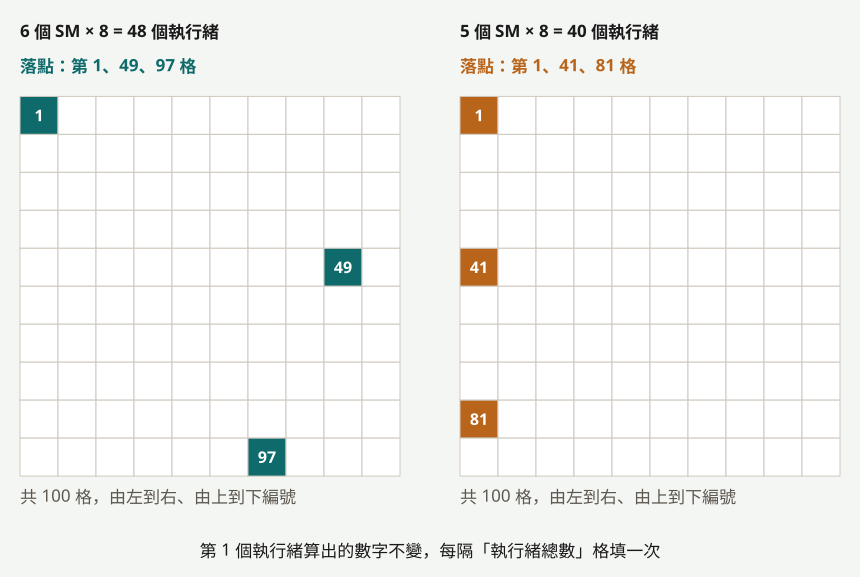
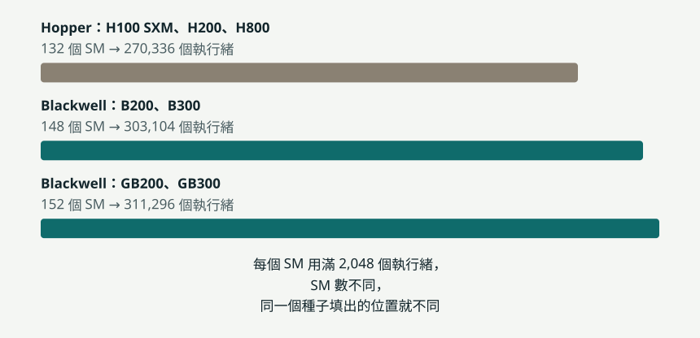
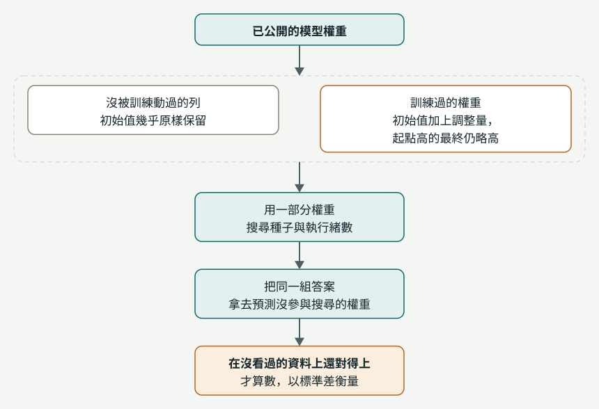
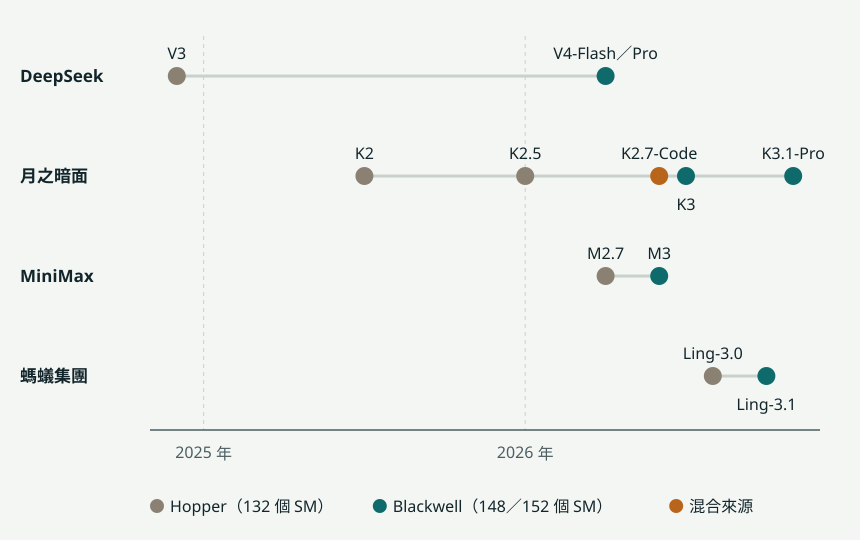
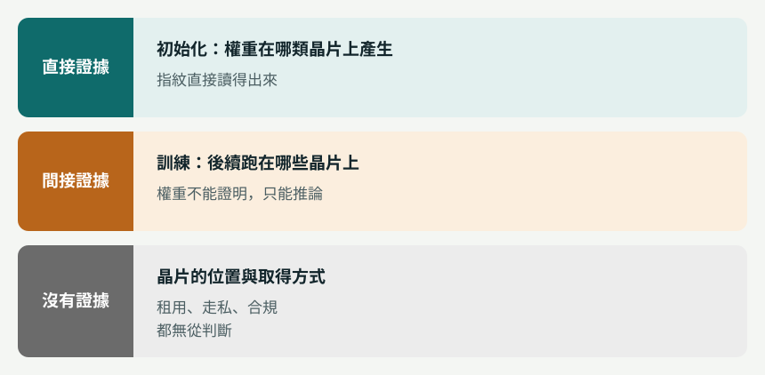
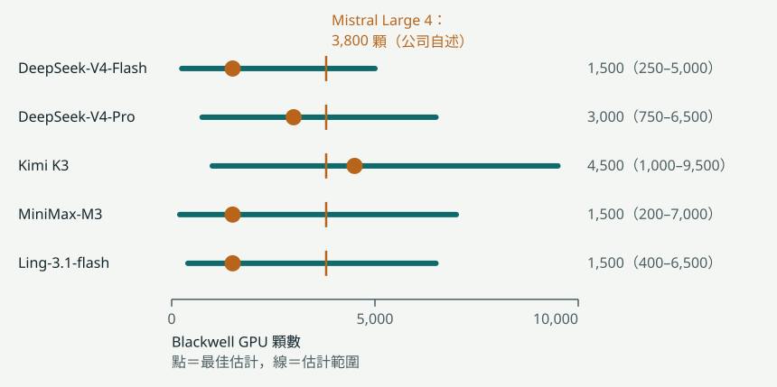

# 權重裡的晶片指紋：六個中國前沿模型的起點，對上受管制的 NVIDIA Blackwell

> 導讀對象：Will DePue，〈Top Chinese Frontier AI Models Carry the Fingerprint of Export-Controlled NVIDIA Blackwell GPUs〉，Unemployment Labs，2026 年 11 月 12 日（同日修訂）。這是單一作者的獨立報告，重現用的程式碼與資料已公開。

## 一個數字，兩台機器

953049583。報告說，這是 DeepSeek 初始化模型時用的亂數種子，而且 DeepSeek-V3 和 DeepSeek-V4-Flash 兩代模型用的是同一個。

作者把這個種子餵給沒改過的 PyTorch，分別在兩台機器上跑。在上一代的 NVIDIA H100 上，程式吐出的數字和 DeepSeek-V3 權重裡保存下來的 57,344 個初始值逐位元相同，卻對不上 V4-Flash 的任何一列。換到新一代的 Blackwell B300，結果反過來：V4-Flash 被挑出來比對的 469 列裡有 461 列相關係數超過 0.99，其中 445 列整列逐位元相同，剩下 8 列被訓練改掉了一部分；V3 則一列都對不上。把種子改動 1，兩台機器都對不出任何一列。

同一家公司、同一個種子，兩代模型卻各自只認一種晶片。V3 在 2024 年 12 月發布，V4 在 2026 年 4 月發布，中間那段時間，DeepSeek 初始化模型用的硬體換了。換上的那一種，出口到中國需要美國政府許可，報告說目前沒有任何核發許可的公開紀錄。

## 過去只有指控

中國 AI 公司用上 Blackwell 的說法早就有了。2025 年 12 月 The Information 報導 DeepSeek 使用了被禁的 NVIDIA 晶片；2026 年 2 月路透引述一位美國政府高層官員，說 DeepSeek 即將發布的模型是用 Blackwell 訓練的；7 月白宮科技政策辦公室主任 Michael Kratsios 點名月之暗面（Moonshot AI）在做 Kimi K3 時取用了被禁的晶片。

這些說法有個共同點：外界沒辦法檢查。晶片在哪個機房、誰租的、跑了什麼，都在公司內部。官員說有，公司不回應，旁觀者只能選擇相信哪一邊。

這份報告換了一個取證的位置。它完全不碰內部消息，證據只來自這些公司自己放上 Hugging Face 的模型權重。公司為了開源而公開的檔案，本身就帶著製造它的硬體留下的痕跡。

## 亂數怎麼會認得晶片

模型的權重是幾十億個可調整的數字。訓練是不斷修改這些數字的過程，但在訓練開始前，它們得先有初始值。PyTorch 用一種叫 Philox 的偽亂數演算法來產生這些初始值：給它一個種子，它就吐出一串看起來隨機、實際上完全固定的數字。同樣的種子永遠得到同一串，工程師才能從同一個起點重跑實驗。

關鍵在「誰來填」。為了快，PyTorch 透過 NVIDIA 的亂數函式庫 cuRAND，把填數字的工作分給 GPU 上大量平行的執行緒。每個執行緒從種子算出自己的一串數字，負責填固定間隔的位置。執行緒有幾個，取決於晶片有幾個處理單元（NVIDIA 稱為 streaming multiprocessor，簡稱 SM）：初始化的量夠大時，每個 SM 會用滿 2,048 個執行緒。

報告用一個縮小版的例子說明。假設一顆 GPU 有 6 個 SM、每個 SM 有 8 個執行緒，總共 48 個。把權重想成一長排空格，第 1 個執行緒填第 1 格，第 2 個填第 2 格，一路到第 48 格；接著第 1 個執行緒的下一個數字落在第 49 格，再下一個落在第 97 格。也就是說，每個執行緒每隔 48 格填一次。

現在種子不變，把 GPU 換成 5 個 SM 的，執行緒變成 40 個。第 1 個執行緒算出的數字一模一樣，落點卻變成第 1、41、81 格。數字都對，位置全亂；在這個例子裡，整張表只剩 6% 的格子和原本相同。

所以要重現一份權重，得同時猜對兩件事：種子決定「是哪些數字」，執行緒數決定「放在哪裡」。種子對、執行緒數錯，得到的是對的數字放錯位置；執行緒數對、種子錯，連數字都不一樣。

真實晶片的數字大得多，規則相同：

| 晶片世代 | 型號 | SM 數 | 初始化用的執行緒數 |
|---|---|---|---|
| Hopper | H100 SXM、H200、H800 | 132 | 270,336 |
| Blackwell | B200、B300 | 148 | 303,104 |
| Blackwell（Grace 搭配） | GB200、GB300 | 152 | 311,296 |

還原出執行緒數，就知道權重的初始排列符合哪一組硬體。它分不出同組裡的型號：讀到 132，可能是 H800，也可能是 H100 或 H200。H800 在 2023 年 10 月以前還能合法出口到中國，H100 則從 2022 年 10 月起就受管制；DeepSeek-V3 是 2024 年 12 月才發布的，單看發布日期，推不出那批晶片是什麼時候、從哪裡來的。

## 訓練過後還剩下什麼

權重公開時已經訓練完了，初始值照理說早被改得面目全非。報告靠兩種殘留把它找回來。

第一種是根本沒被動過的權重。模型的詞表裡常有一些保留給特殊符號、訓練資料中從沒出現過的位置，對應的那幾列權重從頭到尾沒被更新，初始值幾乎原封不動。這些列可以直接和候選的種子、執行緒數算出來的數字逐一比對，對上就是對上。開頭那個兩台機器的實驗，比的就是這種列。

第二種比較隱微。訓練過的權重等於初始值加上訓練期間所有的調整量；只要調整沒有完全蓋過起點的差異，起點高的權重最後還是略微偏高。單看一個權重看不出來，累積幾十萬個就測得到。報告在 DeepSeek-V4-Flash 的 42 層、每層 745,472 個權重上做了這個檢驗：用 Blackwell 的排列去對，初始值和最終值的相關係數是 0.066，換成 Hopper 的排列，相關就消失了。0.066 很小，但樣本數夠大，換算下來是 57 個標準差。作者特別註明，這是在這批權重上觀察到的現象，不保證每一次訓練都會留下。

找法是用一部分權重去搜尋最吻合的種子與執行緒數，再拿這組答案去預測另一批沒參與搜尋的權重，中途不准調整。在沒看過的資料上還對得上，才算數。

搜尋空間大約是 6 兆組種子與排列的組合，試這麼多次，總會有湊巧看起來像的。作者估計，純靠運氣在整個搜尋裡能湊出的最強吻合大約是 8 個標準差，並以此當門檻。六個模型各自最強的證據落在 49 到 1,385 個標準差之間，報告裡最弱的單項檢驗也有 20。

方法本身也對過答案。有 24 個模型的開發者公開講過用了什麼硬體，報告的判讀和這 24 個全部一致：Meta 的 Llama 3.1 讀出 132（H100），EleutherAI 的 Pythia 系列讀出 108（A100），NVIDIA 自己的 Nemotron-3 Ultra 技術報告寫明某階段用 GB200，讀出來是 152，和 Kimi K3 相同。作者自己替這個數字降了溫：其中 11 個是還沒開始訓練的第零步檢查點，同系列模型之間也不獨立，所以這只能算一致性檢查，不能當成準確率。

## 四家公司換機的時間點

| 公司 | 模型 | 發布 | 初始化排列對應的晶片 |
|---|---|---|---|
| DeepSeek | DeepSeek-V3 | 2024 年 12 月 | Hopper（公司自述 H800） |
| | DeepSeek-V4-Flash | 2026 年 4 月 | **Blackwell B200／B300** |
| | DeepSeek-V4-Pro | 2026 年 4 月 | **Blackwell GB200／GB300** |
| 月之暗面 | Kimi K2 | 2025 年 7 月 | Hopper（公司自述 H800） |
| | Kimi K2.5 | 2026 年 1 月 | Hopper（公司自述 H800） |
| | Kimi K3 | 2026 年 7 月 | **Blackwell GB200／GB300** |
| | Kimi K3.1-Pro | 2026 年 11 月 | **Blackwell GB200／GB300** |
| MiniMax | MiniMax-M2.7 | 2026 年 4 月 | Hopper |
| | MiniMax-M3 | 2026 年 6 月 | **Blackwell B200／B300** |
| 螞蟻集團 | Ling-3.0-flash | 2026 年 8 月 | Hopper |
| | Ling-3.1-flash | 2026 年 10 月 | **Blackwell GB200／GB300** |

粗體的四種型號出口到中國都需要美國許可，報告說沒有任何核發紀錄。

四家公司的轉換都發生在 2026 年內，而且是斷代式的：前一個模型還是 Hopper，下一個就是 Blackwell。Kimi K3.1-Pro 和 K3 的種子相同，作者認為它可能是 K3 的檢查點再做後續訓練，所以六個模型實際對應五次訓練。

月之暗面有一個落在中間的模型。Kimi K2.7-Code 比 K3 早六週發布，它保留的 254 列權重是兩個來源的混合：約八成是從 K2.5 繼承來的 Hopper 排列，約兩成是一批符合 148 個 SM 的新數字。每一列的混合比例都相同，作者判斷這是兩個檢查點合併的結果，沒有把它算進六個 Blackwell 模型。

沒換的也不少。阿里巴巴的 Qwen、智譜的 GLM、騰訊、小米、階躍星辰，報告能讀出結果的最新模型都還是 Hopper。美團說 LongCat-2.0 完全在「AI ASIC superpods」上訓練，權重裡也找不到 NVIDIA 的排列；作者從一份後來被刪除的設定檔推測那是華為昇騰 910。

## 這份證據到哪裡為止

報告花了相當的篇幅劃界，這部分比結論更值得細讀。

**它認的是起點。** 指紋說明初始權重是在哪一類硬體上產生的。如果一次訓練在同一批 GPU 上建立權重並訓練到底，指紋就同時指向兩者；但一家公司也可以在甲機器上初始化、搬到乙機器上訓練，或拿既有模型到新硬體上接著練，單憑權重排除不了。反過來也一樣，讀到 Hopper 不代表後面沒用 Blackwell。報告的用詞是：指紋「支持、但不能證明」Blackwell 也負責了訓練。有一個細節讓這個推論稍微站得穩一點：Kimi K3 裡至少有 64 個各自帶種子的程序，全都留下同樣的 152 個 SM 的排列。

**它不知道晶片在哪裡、是誰的。** Blackwell 可以向中國境外的資料中心租用。報告明說，這些發現是「取得先進運算硬體」的技術證據，不能單獨用來認定晶片被走私進中國，也不能認定有人違反出口管制。

前面那兩則指控，說的位置其實不同。路透那則裡，匿名官員說 DeepSeek 的 Blackwell 很可能集中在內蒙古的資料中心，卻不肯說消息怎麼來、晶片怎麼取得。Kratsios 的社群貼文則說，月之暗面取得了配備 GB300 的伺服器，也曾在泰國取用 GB300，可能用來訓練模型。一個指向晶片在中國境內，一個指向境外；權重指紋讀出來的，兩種情況下是同一個數字。

**有另一種晶片能做出相同的排列。** 舊款 NVIDIA 晶片做不到，因為軟體可以少用幾個處理單元，卻沒辦法憑空多出來；中國特供版的 Blackwell 顯示卡每個 SM 的執行緒數不同，也湊不出這兩個總數。AMD 的 MI300X 是例外：它平常用 304 個處理單元，但可以切成兩組 152，或設定成只用 148，而且它的亂數軟體能產生和 NVIDIA 相同的底層序列。作者在實體 MI300X 上確認過，這樣設定真的能重現那兩種排列。

為了分辨，作者找到兩家廠商在產生數字的某一步計算上有細微差異。在 DeepSeek-V4-Flash 保存下來的權重裡，兩家結果不同的值有 377 個，其中 363 個符合 NVIDIA，符合 AMD 的是 0 個。所以結論裡只有 V4-Flash 被稱為「確鑿」。另外五個模型這項檢驗做不出結果，作者的判斷是「非常不可能」：MI300X 預設狀態下產生不了這兩種排列，得有人把整個叢集刻意設定成和 Blackwell 相同的單元數。何況 MI300X 本身也在管制清單上，就算真是它，問題的性質沒變。

**很多模型它讀不了。** 沒公開權重的模型不能查。百度的 PaddlePaddle 框架產生亂數的方式不帶晶片排列，作者還原出了 ERNIE-5.5 的種子（2760），卻判斷不了硬體。在 CPU 上初始化的模型不留 GPU 痕跡，阿里巴巴有幾個 Qwen3 模型就是這樣。DeepSeek-V4.1-Flash 窮舉搜尋後一無所獲。報告強調，讀不出結果對硬體沒有任何說明力。

旁證方面，作者列了兩條公開紀錄：螞蟻集團的 cuLA 程式庫裡有一份 2026 年 3 月 31 日在 GB300 上跑出來的效能測試結果；而 2025 年 6 月，一位 DeepSeek 工程師在 GitHub 上寫過「我們沒有 SM100 的 GPU」，SM100 指的就是 Blackwell。

## 多少顆、多少錢

如果這些模型確實是在初始化它的硬體上訓練完的，規模有多大？報告從模型大小和訓練資料量反推：

| 模型 | 折合 H100 | Blackwell 顆數（最佳估計） | 估計範圍 | 估計訓練天數 |
|---|---|---|---|---|
| DeepSeek-V4-Flash | 3,500 | 1,500 | 250–5,000 | 50 |
| DeepSeek-V4-Pro | 7,500 | 3,000 | 750–6,500 | 70 |
| Kimi K3 | 11,500 | 4,500 | 1,000–9,500 | 70 |
| MiniMax-M3 | 3,500 | 1,500 | 200–7,000 | 60 |
| Ling-3.1-flash | 4,000 | 1,500 | 400–6,500 | 100 |
| 五次訓練合計 | 30,000 | 12,000 | 7,000–22,000 | |

單價取每顆約 7 萬美元，依據是《華爾街日報》報導馬來西亞為字節跳動安裝約 36,000 顆 Blackwell、造價超過 25 億美元。照這個價格，最大的一座叢集約 2 到 3 億美元，五座合計超過 5 億美元。這只算最後一次正式訓練，實驗、失敗的嘗試和推論服務都不在內；作者推測這些公司花在受管制 GPU 上的總額可能以十億美元計。

這一段是整份報告最鬆的地方，作者自己寫了「我們對這些估計沒有把握」。GPU 的實際使用效率沒有任何一家公布，訓練用了多少 token 除 DeepSeek 外都是作者用尚未發表的方法估的，訓練天數是從發布時程猜的，而天數砍半，顆數就加倍。同樣在 Grace Blackwell 上，Mistral 說它用 3,800 顆訓練了和 DeepSeek-V4-Pro 同樣活躍參數量的 Mistral Large 4；Microsoft 說它用 16,000 顆、38 天訓練了規模相近的 MAI-Base-2。照後者的節奏，最大的兩次訓練各需要 8,000 到 9,000 顆。報告當天修訂過一次：初版假設 GPU 跑得和 NVIDIA 官方效能測試一樣有效率，把最大的訓練估成 2,000 到 3,000 顆，之後依已公開的訓練紀錄往上調。

表中各欄的範圍差到十倍以上，讀的時候把它當數量級就好：是「幾千顆」，而非「幾十顆」或「幾十萬顆」。

## 公開的權重會說話

把報告的結論壓到最保守的版本：六個模型的初始權重，排列方式符合受管制的 Blackwell；其中 DeepSeek-V4-Flash 排除了已知的唯一替代解釋，並在實體晶片上重現。至於晶片在哪、怎麼取得、有沒有違法，報告沒有回答，也明說沒有回答。

即使只到這裡，它改變的東西已經不少。出口管制的討論過去靠的是匿名官員和調查報導，現在多了一類任何人都能重跑的證據：程式碼和保存下來的權重列都放在 GitHub，作者說在筆電上幾秒鐘就能驗完，不需要 GPU。「用的是哪一款晶片」這件事，從「你信不信這位官員」變成「你要不要自己跑一次」；至於晶片在哪裡、怎麼取得，仍然只有官員的說法。

另一層意思是對開源模型的。發布權重的時候，沒被訓練到的那幾列保留字元，會把種子和機房裡的晶片型號一起帶出門。DeepSeek 跨世代沿用同一個種子，月之暗面用同一條規則推導種子，這些工程上圖方便的習慣，讓外人能一代一代追下去。

以下是本文的推論，報告沒有這樣寫：這個方法的有效期可能不長。報告自己列出的盲區就是現成的迴避手冊，在 CPU 上初始化、換一個不帶排列特徵的亂數產生方式，或在發布前把沒訓練到的列重新填過，指紋就不見了。阿里巴巴的幾個 Qwen3 模型已經因為在 CPU 上初始化而讀不出任何東西。已經發布的權重收不回去，往後的模型卻未必還會留下同樣的線索；這份報告抓到的，也許是一段不會太長的空檔。

**補述（依官方文件整理，報告沒有談）**
報告沒談、但讀到這裡很自然會問：認得出型號之後，現行規則管得到什麼？以下依官方文件補一段對照。

- 美國出口管理條例（EAR）對「出口」的定義，是把物品實際運出或傳送出美國，另含在美國境內把技術或原始碼交給外國人（視同出口）；條文沒有出現遠端存取或雲端的字眼（15 CFR 734.13）。
- 2026 年 1 月 15 日，BIS 把 H200、MI325X 這一級晶片對中國的審查改成逐案。申請人要提供在中國等八個國家（或最終母公司總部在這些國家）的 IaaS 遠端使用者名單，並證明最終收貨人有嚴格的客戶盤查程序。公告全文沒有出現 Blackwell。
- 5 月 31 日的指引重申一項 2023 年就有的要求：把先進運算品項賣給總部在 D:5 國家（含中國）或澳門、或最終母公司在那裡的實體，不論它人在哪裡都要許可證。指引全文沒有 Blackwell，也沒有遠端存取。
- 眾議院 1 月 12 日以 369 比 22 通過《遠端存取安全法》（Remote Access Security Act），授權 BIS 把出口管制套用到經網路或雲端的遠端取用。法案送到參議院銀行委員會後，目前查到的公開紀錄沒有聽證或表決。

本文沒有查到針對海外雲端業者出租 Blackwell 的專門規則。台灣《新電子科技雜誌》11 月 13 日的一篇分析預測，下一步會是要求海外雲端業者核對、申報中國客戶；那是該文作者的預測，不是官方動作。

這些公司是怎麼用到這些晶片的，報告留白，這篇導讀也沒有答案。

## 來源

- 原報告：Will DePue，[Top Chinese Frontier AI Models Carry the Fingerprint of Export-Controlled NVIDIA Blackwell GPUs](https://unemploymentlabs.com/checkpoint-forensics)，Unemployment Labs，2026-11-12
- 重現用程式碼與資料：[macrogrants/checkpoint-forensics](https://github.com/macrogrants/checkpoint-forensics)
- 路透（轉載），2026-02-23：[China's DeepSeek trained AI model on Nvidia's best chip despite US ban, official says](https://whbl.com/2026/02/23/exclusive-chinas-deepseek-trained-ai-model-on-nvidias-best-chip-despite-us-ban-official-says/)
- Bloomberg，2026-07-22：[US Official Says Moonshot Accessed Banned Nvidia Chips](https://news.bgov.com/artificial-intelligence/white-house-official-says-moonshot-accessed-banned-nvidia-chips)
- Bloomberg 轉述 The Information，2025-12-10：[DeepSeek Has Used Banned Nvidia Chips, The Information Says](https://news.bgov.com/tech-and-telecom-law/deepseek-has-used-banned-nvidia-chips-the-information-says-2)
- 螞蟻集團 cuLA：[BENCHMARK_GB300.md](https://github.com/inclusionAI/cuLA/blob/main/BENCHMARK_GB300.md)
- DeepSeek DeepGEMM：[Pull Request #112](https://github.com/deepseek-ai/DeepGEMM/pull/112)
- 美國出口管理條例對「出口」的定義：[15 CFR 734.13](https://www.law.cornell.edu/cfr/text/15/734.13)
- BIS 逐案審查規則，2026-01-15：[Federal Register 2026-00789](https://www.govinfo.gov/content/pkg/FR-2026-01-15/html/2026-00789.htm)
- BIS 指引，2026-05-31：[Guidance Regarding Enforcement of License Requirements for Advanced Computing Items](https://www.bis.gov/media/documents/bis-guidance-may-31-2026.pdf)
- 眾議院《遠端存取安全法》（H.R. 2683）法案文字：[govinfo](https://www.govinfo.gov/content/pkg/BILLS-119hr2683rfs/html/BILLS-119hr2683rfs.htm)
- 新電子科技雜誌，2026-11-13，對該報告的分析貼文：[Facebook](https://www.facebook.com/share/p/18YJwLWBLB/)
- PyTorch 決定執行緒排列的程式碼：[DistributionTemplates.h](https://github.com/pytorch/pytorch/blob/main/aten/src/ATen/native/cuda/DistributionTemplates.h)

## 製作說明

本文由 AI（Claude）閱讀原報告後撰寫，未經人工逐句審稿。文中的數字與判斷出自原報告；「這份證據到哪裡為止」與結尾兩處另依新聞報導和美國官方文件補述，來源列在文末。標明「本文的推論」的段落除外；原報告的實驗沒有另行重跑。
